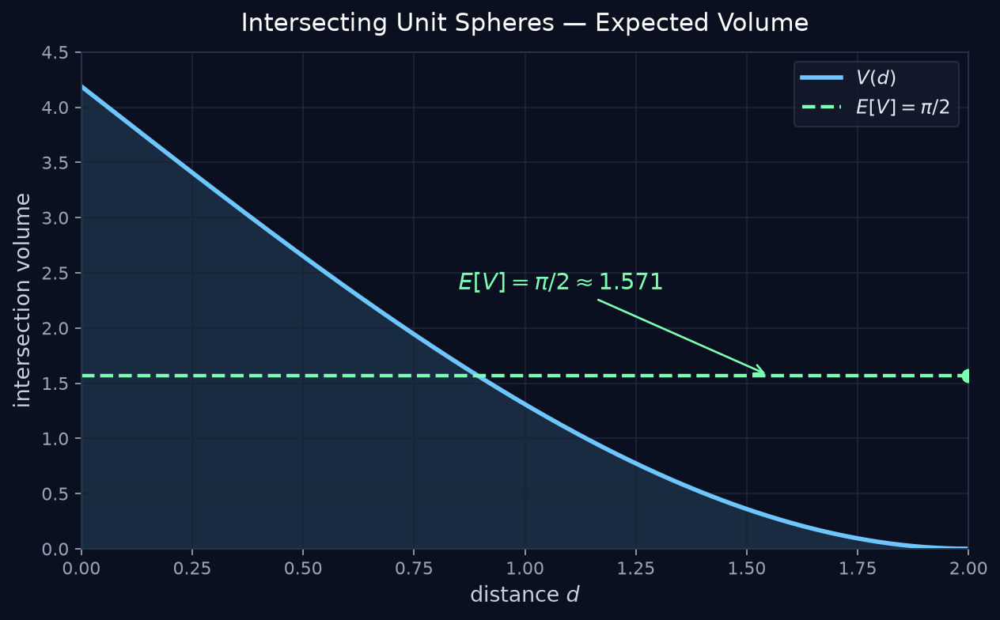

# Beauty of the Universe

Mathematical curiosities — simulations, animations, and answers.

## Problems

### Intersecting Spheres

Two unit spheres; center distance \(d \sim \mathrm{Uniform}(0,2)\).  
**Answer:** expected intersection volume \(E[V] = \pi/2\).

Code: [`Intersecting_Spheres/`](Intersecting_Spheres/)
